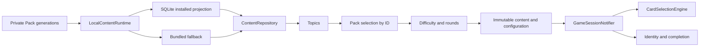

# Current application architecture

This map describes live source. Use [file-map.md](file-map.md) for entry points and [migration decisions](../../docs/migration/DECISIONS.md) for approved contracts and open choices. Dated baseline reports describe their audited commits.

## Startup and content

`main` initializes Flutter, portrait orientation and the bounded image cache, then opens `LocalContentRuntime` before mounting `BiGuessApp` in `ProviderScope`. Committed app-private Pack generations are verified and projected transactionally into a separate SQLite database. This projection is disposable metadata; installed files remain the authority. Empty or failed local storage falls back to `LegacyManifestContentRepository` without deleting failed files or resetting an unsupported database. `biguessUseLegacyContent` explicitly selects rollback; the optional `biguessLocalPackPath` define seeds development content.

`contentRepositoryProvider` supplies synchronous Topic, Pack, Card and installed-Card reads. Screens use canonical IDs for selection; legacy name-keyed providers remain for compatibility. Names are labels and may repeat across IDs. Cached catalog Cards do not count as installed Cards.

`LocalPackFile` validates full-Pack v1 manifests, archive contents, relationships, image sizes/hashes and decoded dimensions. `LocalPackStore` serializes writers in its owning isolate and holds a filesystem lock against other processes, verifies staged private containers, and activates an immutable generation with an atomic pointer rename. Existing generations remain readable by active game snapshots. SQLite schema migrations and installed snapshots are separate from newer cached metadata.

`ContentImageLoader` handles bundled assets and private image references without extracting installed images into the gallery. It bounds decoded dimensions and cache retention. Packaging is practical private storage, not encryption or perfect DRM. See [private images](../../docs/migration/PRIVATE_IMAGES.md).

## Configured gameplay

`TopicsScreen` → `PacksScreen` → `GameConfigurationScreen` → `GameScreen(useSession: true)` uses local content only. Selection supports single, multiple and random Packs within one Topic. Setup rechecks installed content at Start, defaults to Easy and ten rounds, and freezes the configuration/content before assignment.

`GameSessionNotifier` owns temporary in-memory transitions. `CardSelectionEngine` draws eligible Card IDs without replacement, refilling after exhaustion; difficulty is cumulative. Neither watches repository, entitlement or settings changes during a running game. Identity shows the canonical name and local image immediately, with bounded entrance motion and inert image/name taps. Next Round advances once per frame; Finish Game completes the final displayed round without another draw. Free games return through Packs before reset; internal Pro QA permits immediate replay of the same snapshot. Production defaults enforce ten rounds and five stored imported Packs; billing is deferred.

No countdown, timer, score, question counter, winner, authentication or gameplay API belongs to this configured path. [The offline gate](../../docs/migration/OFFLINE_GAMEPLAY_GATE.md) tests process death/restart with real SQLite/private files in an isolated host network namespace. Physical-device and published Shorebird-engine behavior require separate validation.

## Legacy compatibility

`topicPackAssets` → `TopicPackDataSource` → `LegacyManifestContentRepository` preserves bundled order, paths and filename labels. `scripts/generate_manifest.py` regenerates the manifest and optionally pubspec registration; preserve case, spaces and Unicode.

`gameRoundProvider` remains an auto-disposed family keyed by Topic/Pack names. `GameRoundNotifier` owns countdown cancellation, duplicate taps and hint reset; `SelectCharacterUseCase` provides random/non-repeating image selection. Direct legacy `GameScreen` calls retain mystery-box/countdown behavior. The configured flow uses the Card session engine for both imported and bundled content.

Theme and legacy countdown/algorithm/hint settings remain in memory. Complex UI, controllers and private image loading stay in presentation/data layers; the new Card deck and session domain are pure local logic. The legacy selection utility still imports Flutter-dependent `AssetLoader`.

## Update and backend boundaries

`automaticUpdateChecksProvider` suppresses the first-frame update request when SQLite local content or the offline-demo define is active. The bundled fallback retains its existing automatic updater behavior; About offers manual updates. Native Shorebird engine auto-checks are a separate release-policy concern. Do not infer zero native network traffic from ordinary host tests.

`UpdateController` coordinates version/patch/APK services and update dialogs. `CloudDatabaseService` and `backend/biguess-api/` remain a separate unused game-record scaffold. Neither supplies gameplay content. Phase C–F catalog, Studio, remote download/sync, billing and final release gates remain future work.
