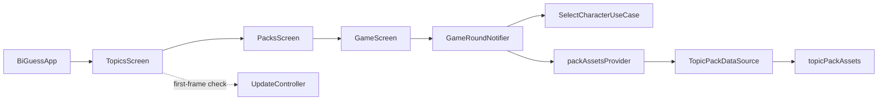

# Current application architecture

This map describes source behavior, not the full target product. Use [file-map.md](file-map.md) to locate code and `docs/migration/DECISIONS.md` for approved migration contracts.

## Startup and navigation

`main` initializes Flutter, requests portrait orientations, and mounts `BiGuessApp` inside `ProviderScope`. `BiGuessApp` watches `themeNotifierProvider`, installs Material 3 light/dark themes, and opens `TopicsScreen`.

Navigation uses `Navigator.push` with animated `PageRouteBuilder` transitions. Topic and pack names are current lookup keys; no stable persisted content IDs are involved. `GameInfoDialog` exposes rules, settings, about, and credits.

## Offline content and round state

- `scripts/generate_manifest.py` scans `assets/images/<Topic>/<Pack>/` into `lib/assets_manifest.dart`; `--sync-pubspec` updates bundle declarations. Display names come from filenames through `AssetLoader.extractCharacterName`; preserve spelling, spaces, and Unicode. The generator accepts WebP, PNG, JPG, and JPEG; the separate dynamic `AssetLoader.loadCategoryAssets` filter accepts WebP, PNG, and JPG.
- `TopicPackDataSource` reads the generated constant map synchronously. Providers expose topics, packs, asset lists, and counts; unknown topic/pack lookups return empty lists or zero.
- `gameRoundProvider` is an auto-disposed family keyed by `({String topic, String pack})`. `GameRoundNotifier.build` watches pack assets and initializes `GameRoundState`; missing images produce the empty state.
- `startCountdown` ignores duplicate taps during countdown, hides the previous image, clears the answer, and resets the global hint provider. A periodic timer updates countdown, then reveals a selection. The timer is canceled on provider disposal and `reset`.
- `SelectCharacterUseCase` accepts an injectable `Random`. Random mode samples the full list; non-repeating mode copies the remaining pool, removes the selected entry, and refills after exhaustion. It returns `CharacterSelectionResult`, not a Card entity.
- `GameScreen` renders empty state, mystery box, countdown, or revealed card and precaches a bounded initial set of images. `AnimatedCharacterCard` provides hint toggling; layout reserves name space so toggling does not move the card.
- Algorithm, countdown duration, hint visibility, and theme are in-memory settings. Read mutable defaults/options from providers and `AppConstants`.

The gameplay chain uses bundled assets and local state. It does not call the record API or perform online selection. The selection use case currently imports `AssetLoader`, which depends on Flutter services; do not describe the entire domain path as platform-independent.

## Optional update and record services

`TopicsScreen` checks for updates after its first frame and listens for `UpdateState`. Optional updates use a snackbar; required APK updates open `UpdateDialog`. About exposes manual checks.

`UpdateController` coordinates `VersionService`, `ShorebirdPatchService`, and `OtaInstallerService`. `VersionService` resolves installed version/device ABIs, fetches remote `version.json`, and evaluates semantic-version/native-change/mandatory decisions. `RemoteVersion.resolveApkUrl` selects a matching ABI with fallbacks. Patch and APK paths perform native work; unit decision tests do not verify delivery, installation, signing, or restart.

`CloudDatabaseService` is a separate Dio client for a simple record API backed by `backend/biguess-api/`. Screens and the round notifier do not invoke it. It does not implement the planned content-distribution API.

## Target boundaries for future tickets

`docs/migration/DECISIONS.md` defines future Card fields (`name`, `image`, `difficulty`, `packId`), one-topic sessions, cumulative difficulty, local no-repeat decks, Free/Pro limits, immutable snapshots, and deletion at safe points. These guide requested migration work; documentation does not make them implemented systems. The target excludes software adjudication of questions, scores, winners, and gameplay timers. Preserve current reveal behavior until its migration ticket and required UX decisions authorize change.
