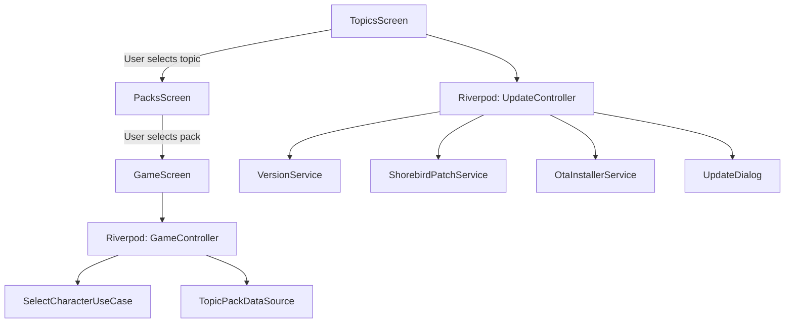

# BiGuess Game — File Map & Architecture

## Directory Tree

```text
.
├── .agents/                          # Agent operational configuration
│   ├── hooks/                        # Lifecycle automation hooks
│   ├── rules/                        # Workspace rules & standards
│   ├── sidecars/                     # Background daemons & status maps
│   ├── skills/                       # On-demand playbooks & workflows
│   └── cache/                        # Cached index and summary
├── assets/
│   ├── fonts/                        # Google Sans font family
│   ├── images/                       # Character cards (Anime, Geography)
│   └── logos/                        # BiGuess brand logos and icons
├── backend/                          # Backend API & Cloudflare D1/Workers
│   └── biguess-api/                  # Worker service, migrations, and wrangler config
├── docs/                             # Project documentation
│   └── migration/                    # Migration baseline and authoritative decisions
│       ├── BASELINE.md               # Frozen behavioral baseline & test matrix (T01)
│       └── DECISIONS.md              # Authoritative decisions & contracts (T02)
├── lib/
│   ├── core/
│   │   ├── constants/app_constants.dart # Dynamic theming, topic configs, defaultVersion
│   │   ├── theme/app_theme.dart         # Material 3 dark/light themes
│   │   └── utils/                       # Asset helpers, URL helpers
│   ├── data/
│   │   └── datasources/                 # Topic pack data source
│   ├── domain/
│   │   ├── models/                      # Character, GameState, SemVer, RemoteVersion
│   │   └── use_cases/                   # SelectCharacterUseCase
│   ├── presentation/
│   │   ├── controllers/                 # UpdateController, AppVersionController
│   │   ├── dialogs/                     # UpdateDialog, GameInfoDialog
│   │   ├── screens/                     # GameScreen, TopicsScreen, PacksScreen
│   │   └── widgets/                     # AnimatedCharacterCard, Countdown, Buttons
│   ├── providers/                       # Riverpod controllers (game, theme, settings)
│   ├── services/                        # VersionService, ShorebirdPatchService, OtaInstallerService
│   └── main.dart                        # Application entrypoint & ProviderScope
├── scripts/                             # Release automation & run scripts
├── test/
│   ├── unit/                            # SemVer, TopicPack, UpdateService unit tests
│   └── widget/                          # Screen & Card widget tests
├── pubspec.yaml                         # Project dependencies and version
├── shorebird.yaml                       # Shorebird app_id for OTA updates
└── version.json                         # Remote OTA update manifest
```

## State Management & Dependency Flow


