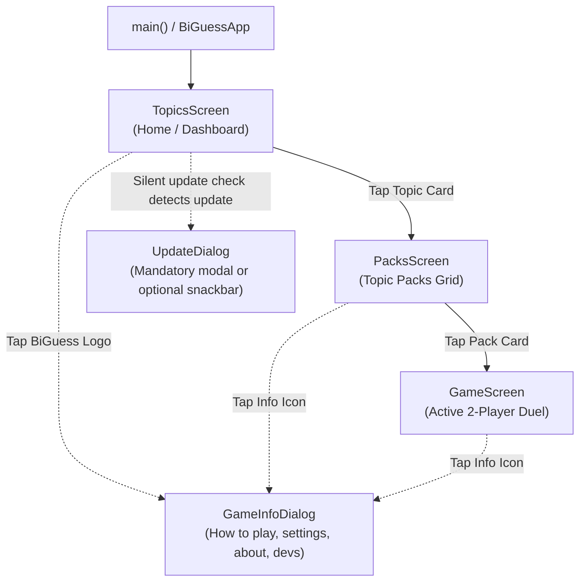

# BiGuess — Behavioral Baseline & Architectural Audit (T01 Freeze)

**Frozen At Ref/Tag:** `baseline-t01`  
**Git Commit SHA (Working HEAD):** `50fd964231df5ebedbe7b3aae1d22fbd9d45e4ca`  
**Base Audited Remote SHA:** `d4ab660faacd1c4f923278456b29f58755ae7040`  
**Timestamp:** 2026-11-06T08:20:45+01:00  
**Branch:** `main`  
**Auditor / Agent:** Antigravity (Pair Programming Assistant)  
**Execution Context:** Flutter 3.47.9 (channel stable), Dart 3.13.7, Fedora Linux 46 x86_64, Android SDK 36.0.0, Java 17  

---

## 1. Executive Summary & Purpose

This document establishes the official frozen behavioral and architectural baseline for **BiGuess** prior to executing the Phase A & Phase B migration roadmaps outlined in `TODO.md` and `BIGUESS_PRODUCT_BLUEPRINT.md`.

No product refactoring was performed for this ticket. The rollback tag `baseline-t01` points directly to commit `50fd964231df5ebedbe7b3aae1d22fbd9d45e4ca` without rewriting history.

```text
git tag -a baseline-t01 50fd964231df5ebedbe7b3aae1d22fbd9d45e4ca -m "Baseline freeze at T01"
```

---

## 2. Actual Navigation & Screen Flows

The current application navigation is imperative and hierarchical, using Flutter's native `Navigator.push()` with custom animated page route transitions:



### Screen Details

1. **`lib/main.dart` — App Entrypoint:**
   - Locks device orientation to portrait (`portraitUp`, `portraitDown`).
   - Wraps root in Riverpod `ProviderScope`.
   - `BiGuessApp` binds dynamic theme from `themeNotifierProvider` and sets `TopicsScreen` as root `home`.

2. **`lib/presentation/screens/topics/topics_screen.dart` — Topics Dashboard:**
   - Displays a staggered list of available topics (`Anime`, `Geography`).
   - Each topic card displays an icon, topic name, pack count, and total card assets.
   - On first frame (`WidgetsBinding.instance.addPostFrameCallback`), triggers a **silent remote version check** (`updateControllerProvider.notifier.checkForUpdates(silent: true)`).
   - Listens to `UpdateState`:
     - If mandatory update: immediately displays blocking `UpdateDialog`.
     - If optional update: displays floating `SnackBar` with an "Update" action button.
     - If update completed: prompts app restart via `restart_app`.
   - Tapping a topic card pushes `PacksScreen(topicName: topic)` with a custom `FadeTransition` + `SlideTransition`.

3. **`lib/presentation/screens/packs/packs_screen.dart` — Packs Grid:**
   - Displays a 2-column `GridView` of packs for the selected topic.
   - Each card displays pack title, icon, and asset count badge (e.g., `"131 items"` or `"Coming soon"` with a lock icon if empty).
   - Tapping an available pack pushes `GameScreen(topicName: topic, packName: pack)` with a `FadeTransition` + `ScaleTransition`.

4. **`lib/presentation/screens/game/game_screen.dart` — Game Duel Screen:**
   - Displays the active 2-player character deduction duel for a single Topic + Pack.
   - In `initState`, precaches the first 5 card images using `precacheImage()`.
   - Center UI alternates between:
     - `GameEmptyState`: if the pack contains zero assets.
     - `AnimatedMysteryBox`: tap-to-start mystery box shown before character draw.
     - `AnimatedCountdown`: animated 3-2-1 timer ring.
     - `_GameCharacterDisplay` / `AnimatedCharacterCard`: revealed character card with 3D flip effect and optional name label.
   - Bottom UI: `AnimatedActionButton` ("Reveal Character" / "Next Mystery Card") + image disclaimer.

5. **Dialogs:**
   - `GameInfoDialog` (`lib/presentation/dialogs/info/game_info_dialog.dart`): Tabbed modal dialog with 4 tabs: "How to Play", "Game Settings", "About Game", and "Developers".
   - `UpdateDialog` (`lib/presentation/dialogs/update/update_dialog.dart`): OTA updater dialog supporting both Shorebird code-push staging and native split-ABI APK download with progress bar and system installer intent.

---

## 3. Verified Content Inventory & Pack Counts

All content in the current codebase is bundled as static WebP images under `assets/images/<Topic>/<Pack>/`. Asset discovery is powered by a generated Dart manifest (`lib/assets_manifest.dart`) and read by `TopicPackDataSource`.

### Verified On-Disk vs Manifest Counts

| Topic | Pack | Format | Files on Disk | Manifest Entries | Avg File Size | Cumulative Size |
| :--- | :--- | :--- | :---: | :---: | :---: | :---: |
| **Anime** | Attack on Titan | WebP | 131 | 131 | 7.7 KB | ~1.01 MB |
| **Anime** | Black Clover | WebP | 67 | 67 | 8.5 KB | ~570 KB |
| **Anime** | Demon Slayer | WebP | 43 | 43 | 9.3 KB | ~400 KB |
| **Anime** | Hunter X Hunter | WebP | 135 | 135 | 6.6 KB | ~891 KB |
| **Anime** | Naruto | WebP | 80 | 80 | 13.6 KB | ~1.09 MB |
| **Anime** | One Piece | WebP | 466 | 466 | 10.7 KB | ~4.99 MB |
| **Geography** | Flags | WebP | 252 | 252 | 11.0 KB | ~2.77 MB |
| **TOTALS** | **2 Topics / 7 Packs** | **WebP** | **1,174** | **1,174** | **10.0 KB avg** | **11.41 MB** |

*Verification command:* `python3 scripts/audit_assets.py` reported **0 issues, 1174 manifest entries matching 1174 disk files**.

---

## 4. Character Reveal & Refresh Engine

- **State Controller:** `GameRoundNotifier` (`lib/providers/game_controller.dart`), an `AutoDisposeFamilyNotifier` keyed by record `({String topic, String pack})`.
- **Selection Engine:** `SelectCharacterUseCase` (`lib/domain/use_cases/select_character_use_case.dart`) supporting two algorithmic strategies:
  1. `CharacterAlgorithm.nonRepeating` (Default): Pulls from `remainingImages` pool. When depleted, resets from `allImages`.
  2. `CharacterAlgorithm.random`: Uniform random selection from `allImages` (immediate repeats possible).
- **Reveal Flow:**
  1. Triggered by tapping the mystery box or the action button.
  2. `startCountdown()` starts a periodic 1-second `Timer` (countdown duration: 1s, 2s, 3s, or 5s; default 3s).
  3. Character name label is hidden (`showCharacterNameHint = false`).
  4. Timer expiry triggers `_revealCharacter()`, selecting the next character asset path and parsing character name.
  5. `_GameCharacterDisplay` renders `AnimatedCharacterCard`. Tapping the card flips it 180 degrees.
  6. The cycle can be repeated endlessly; there is no round limit, score, or match termination.

---

## 5. Settings & Local State Management

All user settings are managed via Riverpod notifiers and stored strictly **in-memory** (no local persistence across app kills):

| Setting Provider | Type | Default Value | Allowed Values | Persistent Storage |
| :--- | :--- | :--- | :--- | :--- |
| `characterAlgorithmProvider` | `CharacterAlgorithm` | `nonRepeating` | `nonRepeating`, `random` | ❌ None (In-Memory) |
| `countdownDurationProvider` | `int` | `3` seconds | `1`, `2`, `3`, `5` seconds | ❌ None (In-Memory) |
| `showCharacterNameHintProvider` | `bool` | `true` | `true`, `false` | ❌ None (In-Memory) |
| `themeNotifierProvider` | `ThemeMode` | `ThemeMode.dark` | `light`, `dark` | ❌ None (In-Memory) |

---

## 6. Network Calls & External Services

| Service | File | Destination / Protocol | Trigger / Purpose |
| :--- | :--- | :--- | :--- |
| **VersionService** | `lib/services/version_service.dart` | `https://raw.githubusercontent.com/.../version.json` (HTTPS GET) | First-frame check in `TopicsScreen` to evaluate update necessity |
| **ShorebirdPatchService**| `lib/services/shorebird_patch_service.dart`| Shorebird Code Push Cloud (App ID: `a0871911-c109-46f9-ac9c-2104ab938018`) | Checks and stages OTA binary hot patches |
| **OtaInstallerService** | `lib/services/ota_installer_service.dart` | GitHub Releases CDN (HTTPS GET via `dio`) | Streams split-ABI APK download with progress tracking |
| **CloudDatabaseService**| `lib/services/cloud_database_service.dart`| `https://biguess-api.biguess-api.workers.dev` (HTTPS GET/POST) | Cloudflare Worker + D1 backend (`/health`, `/records`) (Service integrated with unit tests; not yet bound to UI) |

---

## 7. Dependencies & Release Configuration

### Dependencies (`pubspec.yaml`)
- **SDK:** `sdk: '>=3.0.0 <4.0.0'`, Flutter channel stable
- **State:** `flutter_riverpod: ^2.6.1`
- **Animations & Icons:** `flutter_staggered_animations: ^1.1.1`, `cupertino_icons: ^1.0.2`
- **Networking & OTA:** `dio: ^5.7.0`, `shorebird_code_push: ^2.0.7`, `open_filex: ^4.5.0`, `restart_app: ^1.3.2`
- **Device & System:** `package_info_plus: ^10.2.1`, `device_info_plus: ^13.2.0`, `path_provider: ^2.1.1`, `path: ^1.8.3`, `url_launcher: ^6.3.1`
- **Dev Dependencies:** `flutter_test`, `flutter_lints: ^6.0.0`, `flutter_launcher_icons: ^0.14.3`
- **Missing / Gap:** No SQLite or local database package (`sqflite`, `drift`, etc.) is installed.

### Android Release Configuration (`android/app/build.gradle.kts`)
- `namespace = "com.flutter.gdg_guess_game"`
- `compileSdk = flutter.compileSdkVersion`
- `ndkVersion = "28.2.13676358"`
- `sourceCompatibility = JavaVersion.VERSION_17`, `targetCompatibility = JavaVersion.VERSION_17`
- **Critical Vulnerability / Insecure Config:**
  ```kotlin
  buildTypes {
      release {
          signingConfig = signingConfigs.getByName("debug") // Unsafe: Release APKs signed with debug key!
          isMinifyEnabled = true
          isShrinkResources = true
          proguardFiles(...)
      }
  }
  lint {
      abortOnError = false // Disables lint failure on release builds
      checkReleaseBuilds = false
  }
  ```

---

## 8. Test Execution & Build Verification Logs

### Test 1: Static Analysis (`flutter analyze`)
- **Status:** **PASS**
- **Execution Time:** 4.3s
- **Output:**
  ```text
  Analyzing BiGuess-Game...
  No issues found! (ran in 4.3s)
  ```

### Test 2: Unit & Widget Test Suite (`flutter test`)
- **Status:** **PASS**
- **Passed:** 35 / 35 tests
- **Execution Log:**
  ```text
  00:00 +0: loading test/unit/topic_pack_test.dart
  00:00 +1: TopicPackDataSource returns only Anime and Geography topics
  00:00 +2: TopicPackDataSource returns all anime packs
  00:00 +3: TopicPackDataSource returns flags pack under Geography
  00:00 +4: TopicPackDataSource all packs contain assets
  00:00 +5: TopicPackDataSource geography flags count is 252
  00:00 +6: AssetLoader.extractCharacterName extracts flag names without file extension
  00:00 +7: AssetLoader.extractCharacterName extracts anime character names properly
  00:00 +8: AppConstants Dynamic Theme & Icons known topics return configured colors
  00:00 +9: AppConstants Dynamic Theme & Icons future custom topics dynamically receive valid colors
  00:00 +10: AppConstants Dynamic Theme & Icons future custom topics dynamically receive contextual icons
  00:10 +11: SemVer parsing and comparisons (7 test cases passed)
  00:10 +18: RemoteVersion parsing and ABI resolution (2 test cases passed)
  00:11 +20: VersionService evaluateUpdate decisions (5 test cases passed)
  00:12 +25: CloudDatabaseService & GameRecord Model (4 test cases passed)
  00:14 +29: AnimatedCharacterCard mounts and renders without layout errors
  00:16 +30: BiGuessApp smoke test renders topics screen (6 test cases passed)
  00:17 +35: All tests passed!
  ```

### Test 3: Debug APK Build (`flutter build apk --debug`)
- **Status:** **FAIL**
- **Log Excerpt:**
  ```text
  Running Gradle task 'assembleDebug'...

  FAILURE: Build failed with an exception.

  * What went wrong:
  Execution failed for task ':app:checkDebugAarMetadata'.
  > A failure occurred while executing com.android.build.gradle.internal.tasks.CheckAarMetadataWorkAction
     > /home/saoudi26/Documents/GitHub/PERSONAL/BiGuess-Game/build/device_info_plus/intermediates/aar_metadata/debug/writeDebugAarMetadata/aar-metadata.properties (No such file or directory)

  BUILD FAILED in 15m 49s
  Gradle task assembleDebug failed with exit code 1
  ```
- **Root Cause Analysis:** Android Gradle Plugin (AGP) 9.0.1 in combination with custom redirected root/subproject `buildDirectory` in `android/build.gradle.kts` caused `:device_info_plus` to output only `release` AAR metadata (`build/device_info_plus/intermediates/aar_metadata/release/...`), resulting in `:app:checkDebugAarMetadata` failing to locate the debug variant properties. This build failure is a baseline issue scheduled for remediation under ticket T04.

---

## 9. Observed Behavior vs. Blueprint Target Gap Analysis

| Architectural Dimension | Current HEAD (Observed Behavior) | Blueprint Target (`BIGUESS_PRODUCT_BLUEPRINT.md`) |
| :--- | :--- | :--- |
| **Card Data Model** | Raw asset strings (`assets/images/...`); character name extracted dynamically by regex/string parsing. | Canonical `Card` domain model: stable ID, Name, Image Reference, Difficulty (1=Easy, 2=Medium, 3=Hard), Pack relationship. |
| **Difficulty System** | Non-existent. All cards treated identically without tiering. | Strict difficulty tiers (1, 2, 3) with configurable round difficulty filters. |
| **Game Session Rules** | Endless draw loop; no round configuration, no game end state, no limits. | Configured match length (e.g., 5 or 10 rounds). Free tier capped at **10 rounds per game** (resets from Home screen). |
| **Content Storage & Discovery** | 100% hardcoded assets compiled into APK (`assets/images/`); discoverable via static manifest. | Local SQLite database + private image storage. Content downloaded dynamically from R2/CDN via Catalog API. |
| **Free vs Pro Constraints**| No tier distinction or monetization model implemented. | Free tier: Maximum **5 downloaded Packs stored simultaneously**, up to **10 rounds per game**. Pro tier: unlimited pack storage and unconstrained rounds. |
| **Network Boundaries** | Launch-path network check executed on first frame in `TopicsScreen.initState`. | Core gameplay must be 100% offline. Snapshot safety prevents cloud sync or deletions from interrupting active matches. |
| **Pack Deletion Safety** | Static asset folders; cannot be deleted at runtime. | Deletion tombstones propagate safely from Cloudflare backend; applied to local database only when outside active gameplay. |
| **Multi-Pack Play** | Exactly one Pack playable per session. | Ability to select multiple Packs or random Packs within a single Topic. |
| **Release Signing** | Insecure: Release APKs signed with debug keystore. | Secure external keystore injection via environment variables / CI secrets. |

---

## 10. Known Issues & Baseline Technical Debt

1. **Insecure Release Signing:** `android/app/build.gradle.kts` uses `signingConfigs.getByName("debug")` for the release build type.
2. **Suppressed Release Linting:** `lint { abortOnError = false; checkReleaseBuilds = false }` bypasses static Android quality checks during production compilation.
3. **Launch-Path Network Activity:** First frame of `TopicsScreen` initiates network requests to GitHub raw, violating clean offline-first isolation.
4. **Lack of Local Persistence:** User preferences (algorithm, theme, timer) reset upon app process termination.
5. **No Local SQLite Database:** Content hierarchy is rigid and bundled in APK rather than backed by an upgradeable relational schema.
6. **AGP 9.0.1 Debug Metadata Discrepancy:** Subproject build directory redirection prevents `flutter build apk --debug` from finding debug AAR properties for plugins.
7. **Version Triad Drift:** `pubspec.yaml`, `version.json`, and release history have historical divergences requiring formal synchronization in T04.

---

## 11. Reproducible Baseline Execution Commands

To reproduce this exact baseline verification:

```bash
# 1. Ensure working directory is clean and checkout the baseline tag
git checkout baseline-t01

# 2. Run the automated baseline verification script
./scripts/baseline_check.sh

# Or execute individual commands:
flutter analyze
flutter test
python3 scripts/audit_assets.py
python3 scripts/character_stats.py
flutter doctor -v
```
