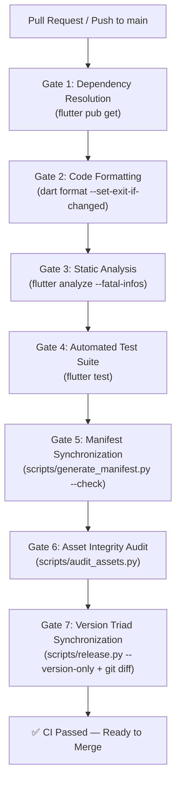

# BiGuess — Continuous Integration & Fast Verification (T03)

**Author:** Antigravity (Pair Programming Assistant)  
**Date:** 2026-11-06  
**Context:** Phase A Migration Roadmap (`TODO.md` T03)  
**Workflow File:** [`.github/workflows/ci.yml`](file:///.github/workflows/ci.yml)  
**Local Verification Script:** [`scripts/baseline_check.sh`](file:///scripts/baseline_check.sh)  

---

## 1. Executive Summary & Purpose

Task **T03** establishes continuous automated verification for the **BiGuess** project via GitHub Actions. It guarantees that every pull request targeting `main` and every direct push to `main` executes a rigorous, multi-stage quality pipeline before integration.

### Core Guarantees
- **Fast Feedback Loop:** The entire verification pipeline runs in under 3 minutes.
- **Hermetic & Cached:** Flutter SDK and Pub dependencies are cached to avoid redundant network overhead.
- **Zero Production Side-Effects:** The CI pipeline does **not** invoke Shorebird production releases, build release APKs, or publish artifacts. Artifact generation is strictly decoupled and gated by dedicated release workflows.
- **Local Parity:** Developers can run the exact same verification suite locally using `bash scripts/baseline_check.sh`.

---

## 2. Workflow Triggers & Concurrency Controls

Defined in [`.github/workflows/ci.yml`](file:///.github/workflows/ci.yml):

```yaml
on:
  push:
    branches:
      - main
  pull_request:
    branches:
      - main

concurrency:
  group: ${{ github.workflow }}-${{ github.ref }}
  cancel-in-progress: true
```

- **PR Validation:** Triggers on all pull requests against `main` (opened, synchronized, reopened).
- **Post-Merge Validation:** Triggers on all merged commits pushed to `main`.
- **Concurrency Cancellation:** In-flight CI runs for obsolete commits on the same pull request or branch are cancelled immediately to prevent runner saturation.

---

## 3. Toolchain Specifications & Pinning Strategy

| Component | Target / Environment | Version / Channel | Pinning / Upgrade Policy |
| :--- | :--- | :--- | :--- |
| **Runner OS** | GitHub Actions Virtual Environment | `ubuntu-latest` (Ubuntu 24.04 LTS) | Managed by GitHub Actions |
| **Flutter SDK** | `subosito/flutter-action@v2` | Channel `stable` (Baseline: Flutter `3.47.x`) | Evaluated on stable release cadence; to lock to an exact patch release, set `flutter-version: '3.47.9'` in `ci.yml`. |
| **Dart SDK** | Bundled with Flutter SDK | Dart `3.13.x` (sound null safety, tall style format) | Aligned with Flutter SDK channel. Minimum SDK constraint in `pubspec.yaml` is `>=3.0.0 <4.0.0`. |
| **Python** | `actions/setup-python@v5` | Python `3.11` | Explicitly pinned in `ci.yml` for reproducible script execution (`generate_manifest.py`, `audit_assets.py`). |
| **Pillow** | Python Image Library (`pip`) | Latest stable (`Pillow`) | Installed in CI environment to enable deep byte/header integrity validation for WebP and PNG assets. |

### Caching Architecture

1. **Flutter Toolchain Cache:**
   ```yaml
   uses: subosito/flutter-action@v2
   with:
     channel: 'stable'
     cache: true
     cache-key: 'flutter-:os:-:channel:-:version:-:arch:-:hash:'
     cache-path: '${{ runner.tool_cache }}/flutter/:channel:-:version:-:arch:'
   ```
2. **Dart Pub Cache:**
   ```yaml
   uses: actions/cache@v4
   with:
     path: ~/.pub-cache
     key: ${{ runner.os }}-pub-${{ hashFiles('**/pubspec.lock') }}
     restore-keys: |
       ${{ runner.os }}-pub-
   ```

---

## 4. The 7 Mandatory Pre-Merge Quality Gates

To merge any code into `main`, the branch must pass all 7 gates sequentially:



### Detailed Gate Breakdown

#### Gate 1: Dependency Resolution
- **Command:** `flutter pub get`
- **Purpose:** Resolves and validates all transitive packages against `pubspec.yaml` and `pubspec.lock`. Fails on unresolvable version constraints or missing dependencies.

#### Gate 2: Code Formatting
- **Command:** `dart format --output=none --set-exit-if-changed lib test`
- **Purpose:** Enforces deterministic Dart formatting across `lib/` and `test/` without allowing unformatted code into `main`. Fails with exit code 1 if any file requires formatting.

#### Gate 3: Static Analysis & Lints
- **Command:** `flutter analyze --fatal-infos`
- **Purpose:** Executes the Dart analyzer configured by `analysis_options.yaml` (including strict casts, strict inference, strict raw types, const constructors, and single quotes). Flags info-level diagnostics as fatal errors.

#### Gate 4: Automated Test Suite
- **Command:** `flutter test`
- **Purpose:** Runs all unit tests (`test/unit/`) and widget tests (`test/widget/`). Verifies domain models, SemVer parsing, update decision matrices, character name extraction, and widget rendering.

#### Gate 5: Topic/Pack Manifest Synchronization
- **Command:** `python3 scripts/generate_manifest.py --check`
- **Purpose:** Scans `assets/images/<Topic>/<Pack>/` on disk and compares against `lib/assets_manifest.dart`. Prevents newly committed card images from being missed in the compiled asset index or deleted files from leaving dangling references.

#### Gate 6: Asset Integrity Audit
- **Command:** `python3 scripts/audit_assets.py`
- **Purpose:** Verifies image headers, detects corrupted files, scans for missing or orphaned assets, flags oversized files (>200 KB), and ensures file names adhere to ASCII/Unicode standards.

#### Gate 7: Version Triad Synchronization
- **Command:** `python3 scripts/release.py --version-only && git diff --exit-code pubspec.yaml version.json lib/core/constants/app_constants.dart`
- **Purpose:** Enforces that the three version sources (`pubspec.yaml`, `version.json`, and `lib/core/constants/app_constants.dart`) are 100% in sync. If any source deviates, `release.py` corrects it and `git diff --exit-code` flags the mismatch as a failure.

---

## 5. Deliberate Failure Reproduction & Acceptance Verification

As required by **T03 acceptance criteria**, each gate was verified by introducing intentional defects and observing that the gate fails fast with the expected exit code and descriptive error output.

### Test 1: Deliberate Code Formatting Defect
- **Injected Fault:** Appended unformatted code / trailing indentation to `lib/core/constants/app_constants.dart`.
- **Command:** `dart format --output=none --set-exit-if-changed lib/core/constants/app_constants.dart`
- **Outcome:** **Caught successfully.** Exit code: `1`.
- **Output:**
  ```text
  Changed lib/core/constants/app_constants.dart
  Formatted 1 file (1 changed) in 0.01 seconds.
  Exit code: 1
  ```

### Test 2: Deliberate Static Analysis Error
- **Injected Fault:** Introduced type mismatch `int deliberateSyntaxError = "wrong type";` in `lib/core/constants/app_constants.dart`.
- **Command:** `flutter analyze --fatal-infos`
- **Outcome:** **Caught successfully.** Exit code: `1`.
- **Output:**
  ```text
  Analyzing BiGuess-Game...
    error • A value of type 'String' can't be assigned to a variable of type 'int'.
            Try changing the type of the variable, or casting the right-hand type to 'int'
            • lib/core/constants/app_constants.dart:126:29 • invalid_assignment
  1 issue found.
  Exit code: 1
  ```

### Test 3: Deliberate Unit Test Failure
- **Injected Fault:** Added failing test assertion `expect(1 + 1, equals(3))` in unit test suite.
- **Command:** `flutter test test/unit/failing_test_scratch.dart`
- **Outcome:** **Caught successfully.** Exit code: `1`.
- **Output:**
  ```text
  00:00 +0: deliberate failure verification [E]
    Expected: <3>
      Actual: <2>
    package:test_api                    expect
    test/unit/failing_test_scratch.dart 4:5  main.<fn>

  00:00 +0 -1: Some tests failed.
  Exit code: 1
  ```

### Test 4: Deliberate Manifest Desynchronization
- **Injected Fault:** Injected an extra comment line into `lib/assets_manifest.dart` without corresponding asset changes on disk.
- **Command:** `python3 scripts/generate_manifest.py --check`
- **Outcome:** **Caught successfully.** Exit code: `1`.
- **Output:**
  ```text
  📊 Total: 2 topics, 7 packs, 1174 images.
  ❌ Manifest is OUT OF SYNC with on-disk assets.
  Run python3 scripts/generate_manifest.py to update it.
  Exit code: 1
  ```

### Test 5: Deliberate Version Triad Desynchronization
- **Injected Fault:** Manually altered `defaultVersion` in `lib/core/constants/app_constants.dart` to an out-of-sync value (`1.0.0`) while `pubspec.yaml` was `1.528.66`.
- **Command:** `python3 scripts/release.py --version-only && git diff --exit-code lib/core/constants/app_constants.dart`
- **Outcome:** **Caught successfully.** Exit code: `1`.
- **Output:**
  ```text
  diff --git a/lib/core/constants/app_constants.dart b/lib/core/constants/app_constants.dart
  -  static const String defaultVersion = '1.0.0';
  +  static const String defaultVersion = '1.528.66';
  Exit code: 1
  ```

---

## 6. Pre-Merge Requirements & Branch Protection Policy

To protect the integrity of `main`:

1. **Required Status Checks:**
   - GitHub branch protection rule on `main` must require the job:
     `Fast Verification & Quality Gates` (`verify`)
   - Branches must be up to date with `main` before merging.
2. **No Direct Pushes to `main` for Production Features:**
   - All substantive changes must go through a feature branch (`feat/*`, `fix/*`) and a Pull Request.
3. **Zero Lint & Warning Tolerance:**
   - `flutter analyze` runs with `--fatal-infos`. Any introduced deprecation, unused variable, or style guideline breach fails the build immediately.
4. **Mandatory Version Increment:**
   - Every merge commit or PR must have its version triad updated in accordance with the project's date-based versioning standard.

---

## 7. Local Developer Runbook

Developers should run the complete gate sequence before opening a Pull Request:

```bash
# 1. Single-command full verification
bash scripts/baseline_check.sh

# 2. Or execute individual checks manually
dart format --output=none --set-exit-if-changed lib test
flutter analyze --fatal-infos
flutter test
python3 scripts/generate_manifest.py --check
python3 scripts/audit_assets.py
python3 scripts/release.py --version-only
```
