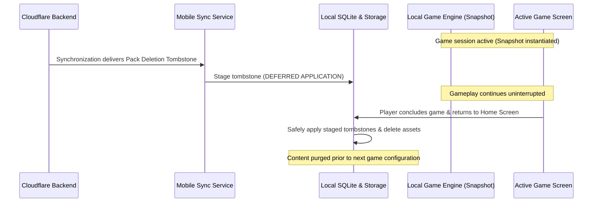
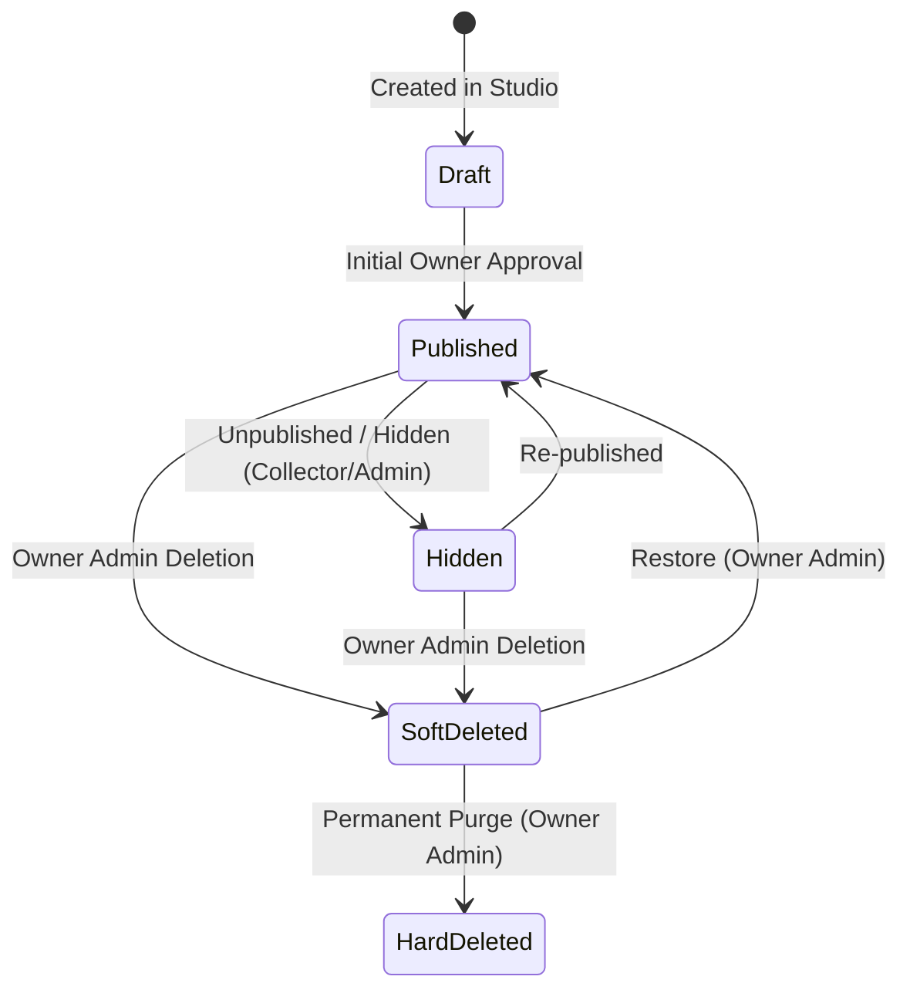

# BiGuess — Architecture & Product Implementation Decisions (T02 Gate)

**Status:** APPROVED / CANONICAL BASELINE  
**Document Date:** 2026-11-06  
**Audited Blueprint:** `BIGUESS_PRODUCT_BLUEPRINT.md` (10,257 lines)  
**Baseline Freeze Ref:** `baseline-t01` (`50fd964231df5ebedbe7b3aae1d22fbd9d45e4ca`)  
**Target Workstreams:** Workstream A (Mobile App), Workstream B (Content Studio), Workstream C (Content Backend)  

---

## 1. Executive Summary & Purpose

This document formalizes the authoritative, non-negotiable architectural and product decisions established in `BIGUESS_PRODUCT_BLUEPRINT.md`. It resolves ambiguities, defines shared contracts across all three parallel workstreams (Mobile, Studio, Backend), and provides concrete operational proposals for open platform choices.

All subsequent tickets across Phase A, Phase B, Phase C, and Phase D must adhere strictly to these decisions. No coding agent or contributor may alter these contracts without an explicit governance review.


---

## 2. Decision 1 — Canonical MVP Card Model

### 2.1 Authoritative Specification
The product-level Card model represents one playable identity and contains **exactly four core attributes**:

| Field | Type | Blueprint Definition | Domain Invariant |
| :--- | :--- | :--- | :--- |
| **`name`** | `String` | Display name of the identity | Non-empty, trimmed, UTF-8 string (e.g., `"Monkey D. Luffy"`). |
| **`image`** | `String` | Reference/path to the character image | Relative URI or asset identifier pointing to high-efficiency WebP image. |
| **`difficulty`** | `int` | Integer level `1`, `2`, or `3` | `1 = Easy`, `2 = Medium`, `3 = Hard`. Cumulative selection filter. |
| **`packId`** | `String` | Foreign key relationship | Stable identifier of the parent Pack (`Topic -> Pack -> Card`). |

### 2.2 Prohibited & Excluded Fields (MVP Scope)
The following attributes are **strictly prohibited** from the product Card model:
* **No `subtitle`**, `description`, `bio`, or `lore`.
* **No `tags`**, `categories`, `keywords`, or `aliases`.
* **No topic-specific semantic attributes** (e.g., `is_human`, `is_alive`, `gender`, `origin_country`, `powers`, `club`, `genre`).

### 2.3 Rationale & Architectural Boundary
1. **Real-Life Primacy:** BiGuess is a verbal, social deduction game. Players discover identity traits through real-world "Yes/No" questions. Embedding trivia or metadata in the software turns a human conversation into a phone-reading session.
2. **Topic-Agnostic Design:** The Game Engine operates purely on generic Cards without domain branches (no `if (card.isAnime)` or `if (card.isFlag)`).
3. **Operational Metadata Separation:** Technical operational fields (`id`, `revision`, `created_at`, `updated_at`, `deleted_at`) exist in backend storage schemas and database tables, but are decoupled from the product-domain Card entity consumed by the local Game Engine.

### 2.4 Blueprint References
* Section 4: *Card* (`BIGUESS_PRODUCT_BLUEPRINT.md#L938-L966`)
* Section 3: *Content Model* (`BIGUESS_PRODUCT_BLUEPRINT.md#L1401-L1427`)
* Section 6: *MVP Data Model* (`BIGUESS_PRODUCT_BLUEPRINT.md#L8068-L8114`)
* Section 4: *Phase 1 — Establish Canonical Content Model* (`BIGUESS_PRODUCT_BLUEPRINT.md#L8666-L8758`)

---

## 3. Decision 2 — Studio Roles, Permissions & Deletion Hierarchy

### 3.1 Role Hierarchy Matrix

| Capability / Action | Owner Admin | Data Collector | Moderator *(Deferred Post-MVP)* |
| :--- | :---: | :---: | :---: |
| **Google Sign-In Authentication** | Yes | Yes | Yes *(Post-MVP)* |
| **Create / Edit Packs (Authorized Scope)** | Yes | Yes | Yes *(Post-MVP)* |
| **Create / Edit Cards** | Yes | Yes | Yes *(Post-MVP)* |
| **Upload Images & Assign Difficulty** | Yes | Yes | Yes *(Post-MVP)* |
| **Manage Permitted Content Metadata** | Yes | Yes | Yes *(Post-MVP)* |
| **Hide Content (Remove from Discovery)** | Yes | Yes | Yes *(Post-MVP)* |
| **Routine Edits to Published Content** | Yes | Yes *(No Owner Bottleneck)* | Yes *(Post-MVP)* |
| **Manage Topics / Taxonomy** | Yes | **NO** | **NO** |
| **Initial Topic / Pack Publishing** | Yes | **NO** | **NO** |
| **Soft Deletion** | **YES** | **STRICTLY PROHIBITED** | Yes *(Post-MVP)* |
| **Restore Soft-Deleted Content** | **YES** | **STRICTLY PROHIBITED** | **NO** |
| **Permanent / Hard Deletion** | **YES** | **STRICTLY PROHIBITED** | **NO** |
| **Manage Studio Users & Assign Roles** | **YES** | **STRICTLY PROHIBITED** | **NO** |

### 3.2 The Zero-Deletion Rule for Data Collectors
* **Data Collectors cannot delete anything.** Neither soft deletion, permanent deletion, nor record destruction may be triggered by a Data Collector.
* Data Collectors cannot restore deleted content.
* Hiding content (`published = false` or `visibility = hidden`) is permitted for Collectors where authorized, but **hiding is not deletion**. Hiding removes items from catalog discovery; deletion generates client tombstones.
* **Server-Side Enforcement:** Permissions must be validated in Cloudflare Workers and database security queries via signed JWT claims / D1 authorization middleware. UI button disabling alone is insufficient.

### 3.3 Deferral of Moderator Role
* The **Moderator role is explicitly deferred to post-MVP** community content pipelines.
* In the MVP, all review, initial publishing, soft deletion, restoration, and permanent destruction authority resides exclusively with the **Owner Admin**.

### 3.4 Blueprint References
* Section 14: *Studio Roles* (`BIGUESS_PRODUCT_BLUEPRINT.md#L2351-L2405`)
* Section 4: *Studio Users and Roles* (`BIGUESS_PRODUCT_BLUEPRINT.md#L3354-L3438`)
* Section 10: *Soft Deletion* (`BIGUESS_PRODUCT_BLUEPRINT.md#L3683-L3718`)

---

## 4. Decision 3 — Free Tier vs. Pro Tier Product & Monetization Rules

BiGuess follows a freemium access model based on usage boundaries, **not** piecemeal franchise gating or artificial card pool restrictions.

### 4.1 Free vs. Pro Feature Matrix

| Feature / Dimension | Free Tier | Pro Tier | Invariant & Guarantees |
| :--- | :--- | :--- | :--- |
| **Pack Storage Limit** | **Maximum 5 downloaded Packs simultaneously** | **Unlimited local Packs** (bounded only by device disk) | Removing a downloaded pack frees a slot. Full access to all Cards inside stored packs. |
| **Rounds Per Game** | **Up to 10 rounds per game** | **Unlimited rounds per game** | Game ends normally after 10 rounds. Returning to Home immediately resets limit. |
| **Round Reset Friction** | **Zero friction** (No ads, no timers, no internet required) | Not applicable | Starting a new game from Home screen is instantaneous and works 100% offline. |
| **Card Pool Access** | **100% of Cards** in downloaded packs | **100% of Cards** in downloaded packs | No artificial 50-card caps, no locked cards, no blurred identities. |
| **Gameplay Mechanics** | Offline, identical rules | Offline, identical rules | Core 2-player deduction experience is 100% identical in Free and Pro. |
| **Authentication Requirement** | **No account / No login** | Non-intrusive receipt / token check | Active gameplay never requires internet connectivity or online entitlement checks. |

### 4.2 Content Monetization Invariant
* **No Individual Franchise Pack Sales:** BiGuess will not sell individual anime or franchise packs (e.g., selling "Naruto Pack" while "One Piece Pack" is free). Commercializing individual third-party franchise packs introduces severe intellectual property, licensing, and publicity-rights liabilities.
* Pro is an access upgrade (unlimited pack slots, unlimited rounds), preserving the integrity of the content catalog.

### 4.3 Blueprint References
* Section 3.21: *Monetization Must Not Damage the Core Experience* (`BIGUESS_PRODUCT_BLUEPRINT.md#L558-L583`)
* *Business Possibilities — Free Version & Pro Version* (`BIGUESS_PRODUCT_BLUEPRINT.md#L7696-L7735`)
* Section 30: *Free-Tier Optimization* (`BIGUESS_PRODUCT_BLUEPRINT.md#L2815-L2855`)

---

## 5. Decision 4 — Cloud Deletion & Gameplay Safety

### 5.1 Immutable Local Content Snapshot
When a player configures and starts a game session, the Game Engine creates an **immutable local content snapshot** in memory:
1. The snapshot contains the filtered list of Cards matching the chosen Topic, selected Packs, and cumulative Difficulty.
2. The active game runs solely from this memory snapshot and local device state.
3. Network calls, background synchronization, and database mutations are strictly barred from altering the running game session.



### 5.2 Safe Point Deletion Application
* **Zero Interruption Guarantee:** Remote updates, edits, unpublishing, and deletions must **never interrupt or alter an active game**.
* When background sync detects an authorized deletion tombstone, the deletion is staged.
* The staged deletion is executed against local SQLite and filesystem storage **only when the player returns to the Home screen or exits gameplay flow**.
* Offline devices cannot detect cloud changes and are never forced to connect.

### 5.3 Blueprint References
* Section 3.3: *Gameplay Snapshot Safety* (`BIGUESS_PRODUCT_BLUEPRINT.md#L122-L134`)
* Section 11: *Deleted Content and the Mobile Game* (`BIGUESS_PRODUCT_BLUEPRINT.md#L3721-L3754`)
* Section 37: *Example: Deleting an Entire Pack* (`BIGUESS_PRODUCT_BLUEPRINT.md#L6050-L6082`)
* Section 21: *Phase 18 — Implement Pack Deletion and Tombstones* (`BIGUESS_PRODUCT_BLUEPRINT.md#L9523-L9554`)

---

## 6. Decision 5 — Administrative State Semantics: Hidden vs. Deleted

BiGuess strictly delineates between two distinct administrative states:



### 6.1 Semantic Differentiation

| Dimension | Hidden / Unpublished | Deleted (Soft-Deleted) |
| :--- | :--- | :--- |
| **Authorized Actors** | Owner Admin, Data Collector (within scope) | **Owner Admin exclusively** (MVP) |
| **Database State** | `is_published = 0`, record active | `deleted_at = <timestamp>`, tombstone generated |
| **Catalog Discovery** | Immediately removed from public catalog | Immediately removed from public catalog |
| **New Downloads** | Blocked for new device downloads | Blocked for new device downloads |
| **Backend Storage** | Record & R2 images remain intact | Soft-deleted in D1; R2 images queued for purge |
| **Tombstone Generation** | **NO tombstone generated** | **Propagating tombstone generated** |
| **Mobile Client Sync** | Does not trigger local device deletion | Triggers local client purge at safe points |
| **Existing Offline Copies** | Remains playable offline *(see Decision 8.3)* | Purged on next sync when returning to Home |

### 6.2 Blueprint References
* Section 3.3: *Hidden vs. Deleted Content* (`BIGUESS_PRODUCT_BLUEPRINT.md#L115-L121`)
* Section 10: *Soft Deletion* (`BIGUESS_PRODUCT_BLUEPRINT.md#L3683-L3718`)
* Section 11: *Deleted Content and the Mobile Game* (`BIGUESS_PRODUCT_BLUEPRINT.md#L3750-L3754`)

---

## 7. Decision 6 — Core Gameplay Invariants

The MVP Game Engine enforces five immutable rules:

### Invariant 1: Exactly One Topic Per Game
* Every game session selects **exactly one Topic** (e.g., `Anime` or `Geography`).
* Multi-topic games (e.g., combining characters from `Anime` and countries from `Geography` in the same duel) are **explicitly unsupported**.
* *Blueprint Reference:* Section 4.3 (`BIGUESS_PRODUCT_BLUEPRINT.md#L648`), Section 2 (`L880-L912`).

### Invariant 2: One or More Packs From That Single Topic
* Players may select:
  1. **Single Pack:** e.g., `Anime -> Naruto`.
  2. **Multiple Selected Packs:** e.g., `Anime -> Naruto + One Piece + Attack on Titan`.
  3. **Random Packs:** BiGuess randomly selects $N$ downloaded packs from the chosen Topic.
* All participating packs must be fully downloaded locally.
* *Blueprint Reference:* Section 6 (`BIGUESS_PRODUCT_BLUEPRINT.md#L1004-L1047`).

### Invariant 3: Cumulative Difficulty Selection
* Three integer levels: `1 = Easy`, `2 = Medium`, `3 = Hard`.
* Difficulty filter is cumulative:
  $$\text{Eligible Cards} = \{ \text{card} \mid \text{card.difficulty} \le \text{selectedDifficulty} \}$$
  - `Selected = Easy` $\rightarrow$ Difficulty `1`
  - `Selected = Medium` $\rightarrow$ Difficulty `1 + 2`
  - `Selected = Hard` $\rightarrow$ Difficulty `1 + 2 + 3`
* **Default difficulty is Easy (`1`).** Difficulty is locked for the duration of the game session.
* *Blueprint Reference:* Section 5 (`BIGUESS_PRODUCT_BLUEPRINT.md#L968-L1002`), Section 4 (`L1429-L1460`).

### Invariant 4: Local Per-Device No-Repeat Card Deck
* Each device builds a local in-memory card pool from the eligible cards.
* Drawn cards are removed from the pool without replacement.
* If the temporary pool is exhausted during play, it is reconstituted from the cached eligible cards to allow endless play.
* **Randomization is 100% local to each device.** Phones do not synchronize drawn cards over the network; identical cards appearing on both phones is an accepted social occurrence resolved verbally by players.
* *Blueprint Reference:* Section 9 (`BIGUESS_PRODUCT_BLUEPRINT.md#L1115-L1149`), Section 10 (`L1151-L1163`).

### Invariant 5: MVP Scope Exclusions (Zero In-App Game Adjudication)
* **No In-Game Timer:** Question time is unrestricted; different characters naturally take different question lengths.
* **No In-Game Scoring:** The app does not track points or question tallies.
* **No In-Game Winner Declaration:** The phone does not determine who won. The human players celebrate, debate, and confirm winners face-to-face.
* *Blueprint Reference:* Section 12: *Scoring and Winning* (`BIGUESS_PRODUCT_BLUEPRINT.md#L1188-L1198`), Section 13: *Timer* (`L1200-L1210`).

---

## 8. Operational & Platform Decisions (Open Choices & Default Proposals)

The following operational choices were identified during baseline analysis and are formalized below with default proposals:

### 8.1 Minimum Supported Operating System Versions
* **Android Minimum SDK:** Set `minSdk = 24` (Android 7.0 Nougat).
  - *Rationale:* Android 24 guarantees native TLS 1.3, modern SQLite 3.14+, and full Shorebird code-push engine compatibility while reaching >96% of global active Android devices. (Flutter default `minSdkVersion = 21` is legacy and lacks clean TLS 1.3 / OpenSSL cipher support).
  - *Android Target / Compile SDK:* `compileSdk = 36`, `targetSdk = 35`.
* **iOS Minimum Target:** Set minimum iOS deployment target to **iOS 14.0** when the iOS platform runner is initialized.
  - *Rationale:* Aligns with Flutter 3.x modern rendering engines and avoids deprecated iOS 12/13 API shims.

### 8.2 Random-Pack Default Count
* **Specification:** When a user selects the "Random Packs" mode for a Topic:
  - **Default Count:** **3 Packs** (or $\min(3, N)$ where $N$ is total downloaded packs in that Topic).
  - **Configuration Range:** The user may adjust the count between $1$ and $\min(N, 5)$ for Free users (up to $\min(N, 20)$ for Pro).
  - *Selection Algorithm:* Uniform random shuffle without replacement among installed packs belonging to the active Topic.

### 8.3 Offline Behavior for Already-Downloaded Unpublished Content
* **Decision / Default Proposal: Retain Locally as Unlisted / Archived.**
  - *Policy:* When content is merely unpublished/hidden in the backend (`is_published = 0`), devices that previously downloaded the pack **retain local offline access**. The pack is marked in the local UI as `[Archived]` or `[Unlisted]`.
  - *Re-download Restriction:* If the user deletes their local copy, they cannot re-download it from the catalog.
  - *Hard Purge Exception:* If content must be forcefully removed from all devices (e.g., severe copyright violation, legal takedown, or malicious content), the Owner Admin executes a **Deletion Operation**, which generates an authoritative tombstone that purges local copies upon synchronization.

### 8.4 Free-Tier Quota Exceeded UX Flow
* When a Free-tier user with 5 downloaded packs attempts to download a 6th pack from the catalog:
  - The app displays a non-blocking modal bottom sheet:
    > **Pack Storage Limit Reached (5/5 Packs)**  
    > Free accounts can store up to 5 packs simultaneously. Remove an installed pack to free up a slot, or upgrade to BiGuess Pro for unlimited storage.
  - Action buttons: `[Manage Installed Packs]` (navigates to local pack manager with 1-tap delete) and `[Learn About Pro]`.
  - The catalog download is prevented until a slot is available.

### 8.5 Game Configuration Defaults
* **Default Number of Rounds:** **5 rounds** (Free range: 1–10; Pro range: 1–99 or Endless).
* **Default Difficulty:** **Easy (Level 1)**.
* **Default Pack Selection:** First installed pack in alphabetical order if no prior game history exists; otherwise restores the user's previous selection within that Topic.

### 8.6 Stable Entity Identifier Strategy
* All Topics, Packs, and Cards must utilize stable, URL-safe, slug-prefixed identifiers:
  - **Topics:** `topic_<slug>` (e.g., `topic_anime`, `topic_geography`).
  - **Packs:** `pack_<topic_slug>_<pack_slug>` (e.g., `pack_anime_naruto`, `pack_anime_one_piece`).
  - **Cards:** `card_<pack_slug>_<uuidv4_short>` (e.g., `card_naruto_7f8a9b2c`).
* Prevents cross-environment collision between Studio drafts, D1 production tables, and local SQLite caches.

---

## 9. Architectural Contract Matrix

A fast-reference cross-workstream contract mapping:

```text
+-------------------+---------------------------------------------------------------------------------+
| Workstream        | Binding Implementation Contract                                                |
+-------------------+---------------------------------------------------------------------------------+
| Workstream A      | 1. Card domain model contains strictly: name, image, difficulty, packId.        |
| (Mobile Engine)   | 2. Game Engine reads from immutable in-memory snapshot; sync never interrupts.  |
|                   | 3. Enforce 5-pack storage ceiling and 10-round game limit on Free tier.        |
|                   | 4. Never require internet connectivity or login during active gameplay.         |
|                   | 5. Apply deletion tombstones only upon return to Home screen.                   |
+-------------------+---------------------------------------------------------------------------------+
| Workstream B      | 1. Studio UI and forms restrict Card inputs strictly to Name, Image, Difficulty.|
| (Content Studio)  | 2. Zero deletion actions for Data Collectors; deletion restricted to Owner.   |
|                   | 3. Hiding/unpublishing is distinct from deletion; clearly labeled in UI.      |
|                   | 4. Topic and Pack creation enforced at correct hierarchy levels.               |
+-------------------+---------------------------------------------------------------------------------+
| Workstream C      | 1. D1 schema enforces foreign keys: Topic -> Pack -> Card.                     |
| (Content Backend) | 2. Deletion endpoints reject requests from non-Owner JWT tokens.               |
|                   | 3. Soft deletion writes tombstone records to sync table with timestamp.        |
|                   | 4. Catalog APIs filter out `is_published = 0` and soft-deleted records.        |
|                   | 5. R2 image bucket serves WebP assets with cache-control headers.              |
+-------------------+---------------------------------------------------------------------------------+
```

---

## 10. Acceptance & Sign-off

- [x] Canonical Card model formalized with exact 4 fields (no subtitles, descriptions, tags, or semantic attributes).
- [x] Zero-deletion rule for Data Collectors established; Owner Admin authority confirmed; Moderator role deferred.
- [x] Free tier (5 packs, 10 rounds, zero friction reset) vs. Pro tier (unlimited) finalized.
- [x] Cloud deletion and gameplay safety snapshot pattern defined with non-interruption guarantee.
- [x] Hidden vs. Deleted distinction formalized with tombstone semantics.
- [x] Five gameplay invariants documented (single topic, cumulative difficulty, local deck, no timer/scoring).
- [x] Operational choices surfaced with concrete default proposals (minSdk 24, iOS 14, 3 random packs, archive unpublished).

*Document established and certified under Ticket T02 (Gate).*
