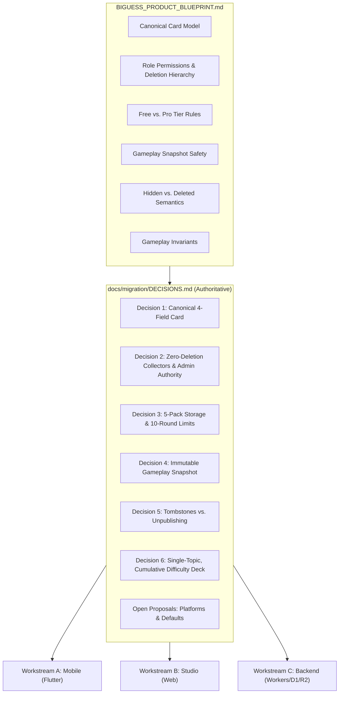
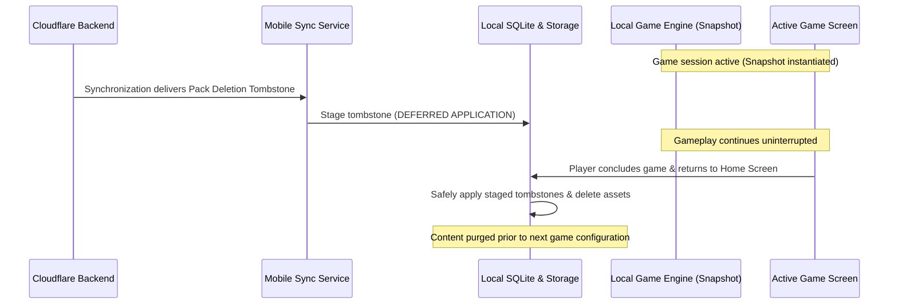
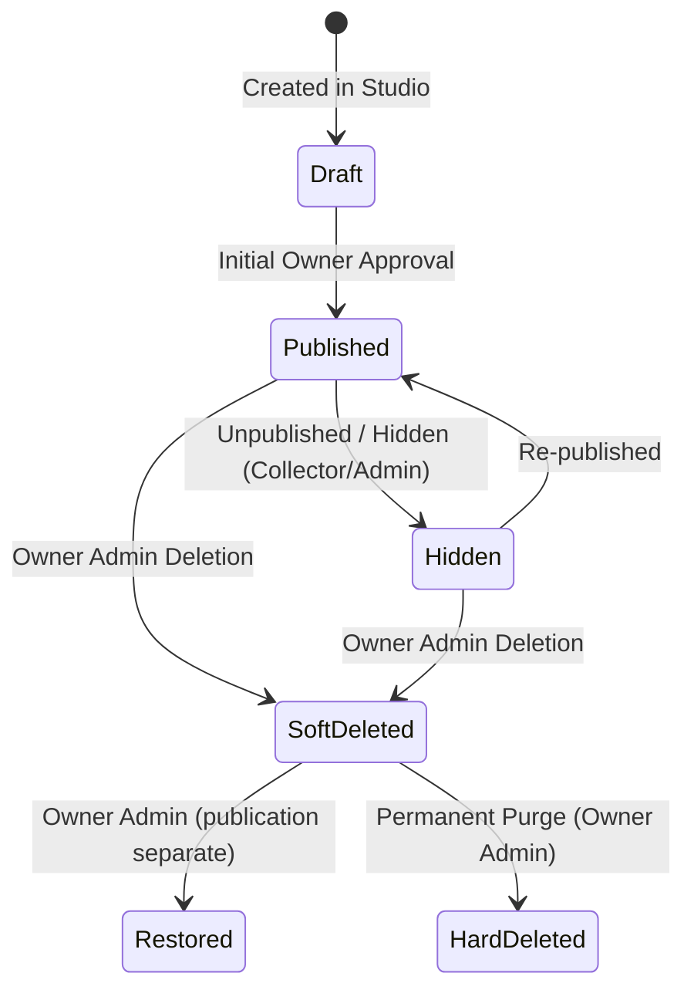

# BiGuess — Architecture & Product Implementation Decisions (T02 Gate)

**Status:** Blueprint contracts recorded in §§2–7 and §9; §8 proposals remain open
**Document Date:** 2026-11-06  
**Audited Blueprint:** `BIGUESS_PRODUCT_BLUEPRINT.md` (10,257 lines)  
**Baseline Freeze Ref:** `baseline-t01` (`50fd964231df5ebedbe7b3aae1d22fbd9d45e4ca`)  
**Target Workstreams:** Workstream A (Mobile App), Workstream B (Content Studio), Workstream C (Content Backend)  

---

## 1. Executive Summary & Purpose

This document formalizes the authoritative, non-negotiable architectural and product decisions established in `BIGUESS_PRODUCT_BLUEPRINT.md`. It resolves ambiguities, defines shared contracts across all three parallel workstreams (Mobile, Studio, Backend), and provides concrete operational proposals for open platform choices.

These are target migration contracts, not claims that the current app implements them. Subsequent tickets must preserve the approved blueprint rules. Section 8 contains unapproved default proposals and must not be treated as authorization to implement them.



---

## 2. Decision 1 — Canonical MVP Card Model

### 2.1 Authoritative Specification
The product-level Card model represents one playable identity and contains **exactly four core attributes**:

| Field | Type | Blueprint Definition | Domain Invariant |
| :--- | :--- | :--- | :--- |
| **`name`** | `String` | Display name of the identity | Non-empty, trimmed, UTF-8 string (e.g., `"Monkey D. Luffy"`). |
| **`image`** | `String` | Reference/path to the character image | Image reference resolved by the content/image layer; storage encoding is separate from the four product fields. |
| **`difficulty`** | `int` | Integer level `1`, `2`, or `3` | `1 = Easy`, `2 = Medium`, `3 = Hard`. Cumulative selection filter. |
| **`packId`** | `String` | Foreign key relationship | Stable identifier of the parent Pack (`Topic -> Pack -> Card`). |

### 2.2 Prohibited & Excluded Fields (MVP Scope)
The following attributes are **strictly prohibited** from the product Card model:
* **No `subtitle`**, `description`, `bio`, or `lore`.
* **No `tags`**, `categories`, `keywords`, or `aliases`.
* **No topic-specific semantic attributes** (e.g., `is_human`, `is_alive`, `gender`, `origin_country`, `powers`, `club`, `genre`).

### 2.3 Rationale & Architectural Boundary
1. **Real-Life Primacy:** BiGuess is a verbal, social deduction game. Players discover identity traits through real-world "Yes/No" questions. Embedding trivia or metadata in the software turns a human conversation into a phone-reading session.
2. **Topic-Agnostic Design:** The Game Engine operates purely on generic Cards without domain branches (no `if (card.isAnime)` or `if (card.isFlag)`).
3. **Technical Identity and Operational Metadata:** The four product fields do not prohibit technical identifiers. The blueprint’s domain examples include Card `id`, `packId`, and `imageReference`. Keep publishing, revision, audit, and deletion metadata separate from gameplay semantics; do not add semantic Card fields.

### 2.4 Blueprint References
* Studio Section 12: [Card Management](../../BIGUESS_PRODUCT_BLUEPRINT.md#L3757-L3772) — explicit four-field model and excluded fields.
* Section 4: *Card* ([blueprint lines L938-L966](../../BIGUESS_PRODUCT_BLUEPRINT.md#L938-L966))
* Section 3: *Content Model* ([blueprint lines L1401-L1427](../../BIGUESS_PRODUCT_BLUEPRINT.md#L1401-L1427))
* Section 6: *MVP Data Model* ([blueprint lines L8068-L8114](../../BIGUESS_PRODUCT_BLUEPRINT.md#L8068-L8114))
* Section 4: *Phase 1 — Establish Canonical Content Model* ([blueprint lines L8666-L8758](../../BIGUESS_PRODUCT_BLUEPRINT.md#L8666-L8758))

---

## 3. Decision 2 — Studio Roles, Permissions & Deletion Hierarchy

### 3.1 Role Hierarchy Matrix

| Capability / Action | Owner Admin | Data Collector |
| :--- | :---: | :---: |
| **Google Sign-In Authentication** | Yes | Yes |
| **Create / Edit Packs (Authorized Scope)** | Yes | Yes |
| **Create / Edit Cards** | Yes | Yes |
| **Upload Images & Assign Difficulty** | Yes | Yes |
| **Manage Permitted Content Metadata** | Yes | Yes |
| **Hide Content (Remove from Discovery)** | Yes | Yes, where authorized |
| **Routine Edits to Published Content** | Yes | Yes, subject to automated validation |
| **Manage Topics / Taxonomy** | Yes | **NO** |
| **Initial Topic / Pack Publishing** | Yes | **NO** |
| **Soft Deletion** | **YES** | **STRICTLY PROHIBITED** |
| **Restore Soft-Deleted Content** | **YES** | **STRICTLY PROHIBITED** |
| **Permanent / Hard Deletion** | **YES** | **STRICTLY PROHIBITED** |
| **Manage Studio Users & Assign Roles** | **YES** | **STRICTLY PROHIBITED** |

### 3.2 The Zero-Deletion Rule for Data Collectors
* **Data Collectors cannot delete anything.** Neither soft deletion, permanent deletion, nor record destruction may be triggered by a Data Collector.
* Data Collectors cannot restore deleted content.
* Hiding content (`published = false` or `visibility = hidden`) is permitted for Collectors where authorized, but **hiding is not deletion**. Hiding removes items from catalog discovery; deletion generates client tombstones.
* **Server-Side Enforcement:** Permissions must be validated in Cloudflare Workers and database security queries via signed JWT claims / D1 authorization middleware. UI button disabling alone is insufficient.

### 3.3 Deferral of Moderator Role
* The **Moderator role is explicitly deferred to post-MVP** community content pipelines. Future Moderators may review community submissions and soft-delete within their authorized scope; other permissions remain outside this MVP contract.
* In the MVP, all review, initial publishing, soft deletion, restoration, and permanent destruction authority resides exclusively with the **Owner Admin**.

### 3.4 Blueprint References
* Section 14: *Studio Roles* ([blueprint lines L2351-L2405](../../BIGUESS_PRODUCT_BLUEPRINT.md#L2351-L2405))
* Section 4: *Studio Users and Roles* ([blueprint lines L3354-L3438](../../BIGUESS_PRODUCT_BLUEPRINT.md#L3354-L3438))
* Section 10: *Soft Deletion* ([blueprint lines L3683-L3718](../../BIGUESS_PRODUCT_BLUEPRINT.md#L3683-L3718))

---

## 4. Decision 3 — Free Tier vs. Pro Tier Product & Monetization Rules

BiGuess follows a freemium access model based on usage boundaries, **not** piecemeal franchise gating or artificial card pool restrictions.

### 4.1 Free vs. Pro Feature Matrix

| Feature / Dimension | Free Tier | Pro Tier | Invariant & Guarantees |
| :--- | :--- | :--- | :--- |
| **Pack Storage Limit** | **Maximum 5 downloaded Packs simultaneously** | **Unlimited local Packs** (bounded only by device disk) | Removing a downloaded pack frees a slot. Full access to all Cards inside stored packs. |
| **Rounds Per Game** | **Up to 10 rounds per game** | **Unlimited rounds per game** | A Free game ends after its configured rounds, at most 10. Starting a new game from Home resets the limit. |
| **Round Reset Friction** | **Zero friction** (No ads, no timers, no internet required) | Not applicable | Starting a new game from Home screen is instantaneous and works 100% offline. |
| **Card Pool Access** | **100% of Cards** in downloaded packs | **100% of Cards** in downloaded packs | No artificial 50-card caps, no locked cards, no blurred identities. |
| **Gameplay Mechanics** | Offline, identical rules | Offline, identical rules | Core 2-player deduction experience is 100% identical in Free and Pro. |
| **Authentication Requirement** | **No account / No login to play** | No mandatory login during active gameplay | Active gameplay never requires internet connectivity or online entitlement checks; billing and receipt mechanisms are not decided here. |

### 4.2 Content Monetization Invariant
* **Initial Content Monetization:** The initial model must not depend on selling individual third-party franchise Packs. The blueprint leaves properly licensed commercial content opportunities for later consideration.
* Pro is an access upgrade (unlimited pack slots, unlimited rounds), preserving the integrity of the content catalog.

### 4.3 Blueprint References
* Section 3.21: *Monetization Must Not Damage the Core Experience* ([blueprint lines L558-L583](../../BIGUESS_PRODUCT_BLUEPRINT.md#L558-L583))
* *Business Possibilities — Free Version & Pro Version* ([blueprint lines L7696-L7735](../../BIGUESS_PRODUCT_BLUEPRINT.md#L7696-L7735))
* Section 30: *Free-Tier Optimization* ([blueprint lines L2815-L2855](../../BIGUESS_PRODUCT_BLUEPRINT.md#L2815-L2855))

---

## 5. Decision 4 — Cloud Deletion & Gameplay Safety

### 5.1 Immutable Local Content Snapshot
When a player configures and starts a game session, the Game Engine creates an **immutable local content snapshot** in memory:
1. The snapshot contains the filtered list of Cards matching the chosen Topic, selected Packs, and cumulative Difficulty.
2. The active game runs solely from this memory snapshot and local device state.
3. Network calls, background synchronization, and database mutations are strictly barred from altering the running game session.



### 5.2 Safe Point Deletion Application
* **Zero Interruption Guarantee:** Remote updates, edits, unpublishing, and deletions must **never interrupt or alter an active game**.
* When background sync detects an authorized deletion tombstone, the deletion is staged.
* Staged deletions and content updates are applied to local storage **only when the player returns to the Home screen or exits gameplay flow**; the active snapshot and its image resources remain usable until then.
* Offline devices cannot detect cloud changes and are never forced to connect.

### 5.3 Blueprint References
* Section 3.3: *Gameplay Snapshot Safety* ([blueprint lines L122-L134](../../BIGUESS_PRODUCT_BLUEPRINT.md#L122-L134))
* Section 11: *Deleted Content and the Mobile Game* ([blueprint lines L3721-L3754](../../BIGUESS_PRODUCT_BLUEPRINT.md#L3721-L3754))
* Section 37: *Example: Deleting an Entire Pack* ([blueprint lines L6050-L6082](../../BIGUESS_PRODUCT_BLUEPRINT.md#L6050-L6082))
* Section 21: *Phase 18 — Implement Pack Deletion and Tombstones* ([blueprint lines L9523-L9554](../../BIGUESS_PRODUCT_BLUEPRINT.md#L9523-L9554))

---

## 6. Decision 5 — Administrative State Semantics: Hidden vs. Deleted

BiGuess strictly delineates between two distinct administrative states. Publishing is at Topic/Pack level; individual Cards have Active/Hidden visibility ([Studio §22, Content Status and Visibility](../../BIGUESS_PRODUCT_BLUEPRINT.md#L4106-L4137)). The diagram summarizes these separate state changes and does not grant Collectors initial publishing authority:



### 6.1 Semantic Differentiation

| Dimension | Hidden / Unpublished | Deleted (Soft-Deleted) |
| :--- | :--- | :--- |
| **Authorized Actors** | Owner Admin, Data Collector (within scope) | **Owner Admin exclusively** (MVP) |
| **Database State** | Unpublished Topic/Pack or Hidden Card; record retained | Soft-deleted record plus tombstone; exact schema is defined by the backend contract |
| **Catalog Discovery** | Immediately removed from public catalog | Immediately removed from public catalog |
| **New Downloads** | Blocked for new device downloads | Blocked for new device downloads |
| **Backend Storage** | Record & images retained | Retained for Owner review/restoration; permanent destruction is a separate Owner operation |
| **Tombstone Generation** | **NO tombstone generated** | **Propagating tombstone generated** |
| **Mobile Client Sync** | Existing-download policy remains open; hiding does not itself authorize a deletion tombstone | Triggers local client purge at safe points |
| **Existing Offline Copies** | **Open decision**; retention/playability is a proposal in §8.3 | Purged after sync at Home or outside active gameplay |

### 6.2 Blueprint References
* Section 3.3: *Hidden vs. Deleted Content* ([blueprint lines L115-L121](../../BIGUESS_PRODUCT_BLUEPRINT.md#L115-L121))
* Section 10: *Soft Deletion* ([blueprint lines L3683-L3718](../../BIGUESS_PRODUCT_BLUEPRINT.md#L3683-L3718))
* Section 11: *Deleted Content and the Mobile Game* ([blueprint lines L3750-L3754](../../BIGUESS_PRODUCT_BLUEPRINT.md#L3750-L3754))

---

## 7. Decision 6 — Core Gameplay Invariants

The MVP Game Engine enforces five immutable rules:

### Invariant 1: Exactly One Topic Per Game
* Every game session selects **exactly one Topic** (e.g., `Anime` or `Geography`).
* Multi-topic games (e.g., combining characters from `Anime` and countries from `Geography` in the same duel) are **explicitly unsupported**.
* *Blueprint Reference:* Section 4.3 ([blueprint lines L648](../../BIGUESS_PRODUCT_BLUEPRINT.md#L648)), Section 2 ([blueprint lines L880-L912](../../BIGUESS_PRODUCT_BLUEPRINT.md#L880-L912)).

### Invariant 2: One or More Packs From That Single Topic
* Players may select:
  1. **Single Pack:** e.g., `Anime -> Naruto`.
  2. **Multiple Selected Packs:** e.g., `Anime -> Naruto + One Piece + Attack on Titan`.
  3. **Random Packs:** BiGuess randomly selects $N$ downloaded packs from the chosen Topic.
* All participating packs must be fully downloaded locally.
* *Blueprint Reference:* Section 6 ([blueprint lines L1004-L1047](../../BIGUESS_PRODUCT_BLUEPRINT.md#L1004-L1047)).

### Invariant 3: Cumulative Difficulty Selection
* Three integer levels: `1 = Easy`, `2 = Medium`, `3 = Hard`.
* Difficulty filter is cumulative:
  $$\text{Eligible Cards} = \{ \text{card} \mid \text{card.difficulty} \le \text{selectedDifficulty} \}$$
  - `Selected = Easy` $\rightarrow$ Difficulty `1`
  - `Selected = Medium` $\rightarrow$ Difficulty `1 + 2`
  - `Selected = Hard` $\rightarrow$ Difficulty `1 + 2 + 3`
* **Default difficulty is Easy (`1`).** Difficulty is locked for the duration of the game session.
* *Blueprint Reference:* Section 5 ([blueprint lines L968-L1002](../../BIGUESS_PRODUCT_BLUEPRINT.md#L968-L1002)), Section 4 ([blueprint lines L1429-L1460](../../BIGUESS_PRODUCT_BLUEPRINT.md#L1429-L1460)).

### Invariant 4: Local Per-Device No-Repeat Card Deck
* Each device builds a local in-memory card pool from the eligible cards.
* Drawn cards are removed from the pool without replacement.
* If the temporary pool is exhausted during play, it is reconstituted from the cached eligible cards to allow endless play.
* **Randomization is 100% local to each device.** Phones do not synchronize drawn cards over the network; identical cards appearing on both phones is an accepted social occurrence resolved verbally by players.
* *Blueprint Reference:* Section 9 ([blueprint lines L1115-L1149](../../BIGUESS_PRODUCT_BLUEPRINT.md#L1115-L1149)), Section 10 ([blueprint lines L1151-L1163](../../BIGUESS_PRODUCT_BLUEPRINT.md#L1151-L1163)).

### Invariant 5: MVP Scope Exclusions (Zero In-App Game Adjudication)
* **No In-Game Timer:** Question time is unrestricted; different characters naturally take different question lengths.
* **No In-Game Scoring:** The app does not track points or question tallies.
* **No In-Game Winner Declaration:** The phone does not determine who won. The human players celebrate, debate, and confirm winners face-to-face.
* *Blueprint Reference:* Section 12: *Scoring and Winning* ([blueprint lines L1188-L1198](../../BIGUESS_PRODUCT_BLUEPRINT.md#L1188-L1198)), Section 13: *Timer* ([blueprint lines L1200-L1210](../../BIGUESS_PRODUCT_BLUEPRINT.md#L1200-L1210)).

---

## 8. Operational & Platform Choices (Open; Default Proposals Only)

Every proposal below remains pending product/platform acceptance. None changes the current app or overrides §§2–7. Record acceptance and validation in the relevant implementation ticket before adopting a proposal.

### 8.1 Minimum Supported Operating System Versions
* **Open:** Minimum Android/iOS versions and explicit compile/target SDK policy.
* **Default proposal:** Evaluate Android `minSdk = 24` and iOS 14.0 when platform support is implemented. Validate against the selected Flutter SDK, plugins, Shorebird support, and intended devices before acceptance.
* **Current source:** `android/app/build.gradle.kts` delegates min/compile/target SDK values to Flutter. The repository has no iOS runner. No SDK change is authorized by this document; compile/target values need separate toolchain and distribution-policy verification.

### 8.2 Random-Pack Default Count
* **Open:** Default count and selection UX.
* **Default proposal:** Select `min(3, N)` Packs, where `N` is the number of locally installed playable Packs in the chosen Topic; allow adjustment from 1 to `N`. Disable Start when `N = 0`.
* **Default proposal:** Shuffle without replacement within that Topic. This adds no independent Pro Pack cap; the approved Free storage limit already bounds installed Packs.

### 8.3 Offline Behavior for Already-Downloaded Unpublished Content
* **Open:** Whether previously downloaded hidden/unpublished content remains playable after synchronization, and how to show its availability. The blueprint explicitly leaves this unresolved ([Hidden vs. Deleted Content](../../BIGUESS_PRODUCT_BLUEPRINT.md#L115-L124), [Deletion vs. Unpublishing](../../BIGUESS_PRODUCT_BLUEPRINT.md#L3750-L3754)).
* **Default proposal:** Retain local playability, optionally showing an Unlisted label. This is a candidate policy, not an approved rule. Decide Topic/Pack unpublishing and individual Card hiding behavior together before implementing synchronization.
* **Approved boundary:** New catalog discovery/downloads are unavailable while hidden/unpublished. Authorized deletion remains a separate tombstone operation, applied at safe points after synchronization; an offline device cannot detect it before reconnecting.

### 8.4 Free-Tier Quota Exceeded UX Flow
* **Approved boundary:** Prevent a sixth simultaneous Free Pack installation; removing an installed Pack frees a slot. No login, ad, or network check may block a new offline game.
* **Open / default proposal:** Explain the 5-Pack limit in a bottom sheet with Manage Installed Packs and optional Pro information. Exact copy, layout, and local removal interaction await the download-manager ticket.

### 8.5 Game Configuration Defaults
* **Open / default proposal:** Start with 5 rounds; Free configuration remains 1–10, while Pro has no product round cap. The Pro configuration UI remains to be decided.
* **Approved default:** Easy (Level 1), per [Game Model §5, Difficulty](../../BIGUESS_PRODUCT_BLUEPRINT.md#L968-L1002).
* **Open / default proposal:** Restore the previous valid Pack selection within the Topic, otherwise select the first installed playable Pack alphabetically. Persistence and fallback UX await their implementation ticket.

### 8.6 Stable Entity Identifier Strategy
* **Approved boundary:** Topic, Pack, and Card require stable technical identifiers and correct parent relationships ([MVP Data Model](../../BIGUESS_PRODUCT_BLUEPRINT.md#L8079-L8100)).
* **Open:** Identifier generation, collision handling, import mapping, and rename behavior across Studio, backend, and local storage.
* **Default proposal:** Use opaque full UUIDs with stable import mappings; preserve IDs when display names change. Validate collision handling and idempotent import behavior in the shared model/API contracts. No slug or shortened-UUID format is mandated here.

---

## 9. Architectural Contract Matrix

A fast-reference cross-workstream contract mapping:

```text
+-------------------+---------------------------------------------------------------------------------+
| Workstream        | Binding Implementation Contract                                                |
+-------------------+---------------------------------------------------------------------------------+
| Workstream A      | 1. Card has four product fields; technical identity remains permitted (§2).      |
| (Mobile Engine)   | 2. Game Engine reads from immutable in-memory snapshot; sync never interrupts.  |
|                   | 3. Enforce 5-pack storage ceiling and 10-round game limit on Free tier.        |
|                   | 4. Never require internet connectivity or login during active gameplay.         |
|                   | 5. Apply content changes at Home or outside active gameplay (§5).               |
+-------------------+---------------------------------------------------------------------------------+
| Workstream B      | 1. Studio UI and forms restrict Card inputs strictly to Name, Image, Difficulty.|
| (Content Studio)  | 2. Zero deletion actions for Data Collectors; deletion restricted to Owner.   |
|                   | 3. Hiding/unpublishing is distinct from deletion; clearly labeled in UI.      |
|                   | 4. Topic and Pack creation enforced at correct hierarchy levels.               |
+-------------------+---------------------------------------------------------------------------------+
| Workstream C      | 1. D1 schema enforces foreign keys: Topic -> Pack -> Card.                     |
| (Content Backend) | 2. Deletion endpoints reject requests from non-Owner JWT tokens.               |
|                   | 3. Soft deletion writes tombstone records to sync table with timestamp.        |
|                   | 4. Catalog APIs filter out `is_published = 0` and soft-deleted records.        |
|                   | 5. R2 image bucket serves WebP assets with cache-control headers.              |
+-------------------+---------------------------------------------------------------------------------+
```

---

## 10. Acceptance & Sign-off

- [x] Canonical Card model formalized with exact 4 fields (no subtitles, descriptions, tags, or semantic attributes).
- [x] Zero-deletion rule for Data Collectors established; Owner Admin authority confirmed; Moderator role deferred.
- [x] Free tier (5 packs, 10 rounds, zero friction reset) vs. Pro tier (unlimited) finalized.
- [x] Cloud deletion and gameplay safety snapshot pattern defined with non-interruption guarantee.
- [x] Hidden vs. Deleted distinction formalized with tombstone semantics.
- [x] Five gameplay invariants documented (single topic, cumulative difficulty, local deck, no timer/scoring).
- [x] Operational choices surfaced with concrete default proposals (minSdk 24, iOS 14, 3 random packs, archive unpublished).

*T02 records the approved blueprint contracts and surfaces pending choices. The §8 proposals are not sign-off for implementation.*
